# IAP · LU7 · Git and GitHub, step by step

Example of the course ISA NUM 1 · Introduction to Algorithms and Programming (UPPA).

The program `hello.swift` asks a name and an age. Its history shows the steps of the LU7 video:

| Version | Content |
|---|---|
| first commit | no check: an empty name is accepted, a wrong age stops the program |
| `v1.0` | branches `check-name` and `check-age`: the name and the age are checked |
| `v2.0` | branch `functions`: the same checks, in `readName()` and `readAge()` |

Try it:

```
git clone https://github.com/eetlse/iap-github-lu.git
cd iap-github-lu
git log --oneline --graph --all
git switch --detach v1.0
swift hello.swift
git switch main
swift hello.swift
```

## Course notes (LU7 slides)


### LU7 · Versioning: managing software over time

Welcome to learning unit 7.

Until now, you wrote small programs, you tested them, and you submitted them. But a real program is never finished: it changes many times during its life.

In this unit, we learn how to manage these changes over time. We will use Git, the tool that almost every developer uses today, and GitHub, the website where developers share their code.

At the end of the unit, you will put your own Battleship program on GitHub.


### Context: software is alive

- Software answers the needs of users and of other systems
- These needs change, so the software must change too
- Software also has errors (bugs) that must be corrected
- Every change creates a new version of the program

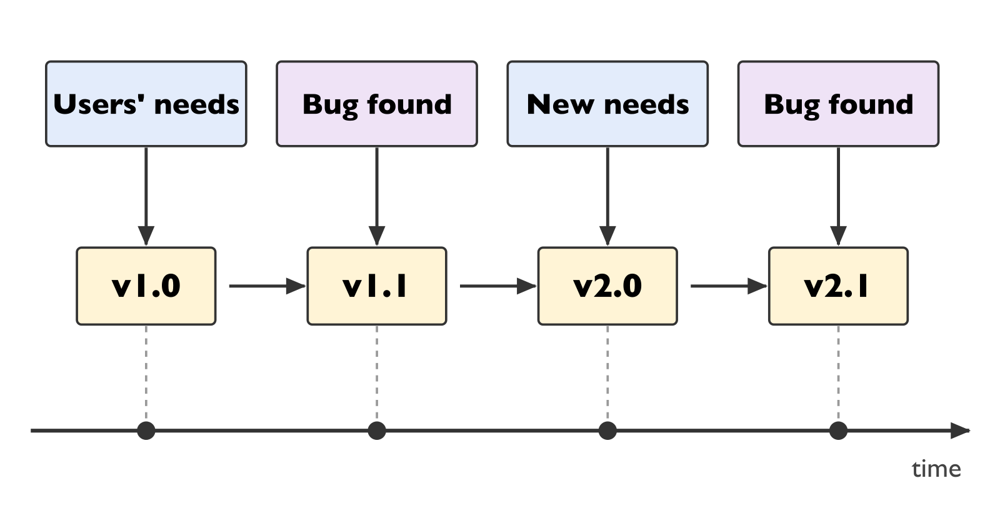

Software answers needs: The needs of its users, and sometimes the needs of other programs that work with it.

These needs change. Users ask for new features, or the way they work changes. So the software must change too.

Software also has errors, that we call bugs. When a bug is found, we correct it, and this is also a change.

Every change creates a new version of the program.

Look at the picture: the first needs give version 1.0. A bug is found: we correct it, and we get version 1.1. New needs arrive: we get version 2.0. And so on, all along the life of the program.


### Context: many developers, at the same time

- Several developers work on the same program, sometimes on the same file
- Their changes must be combined without losing work
- We need to know who changed what, when, and why
- Solution: version control systems

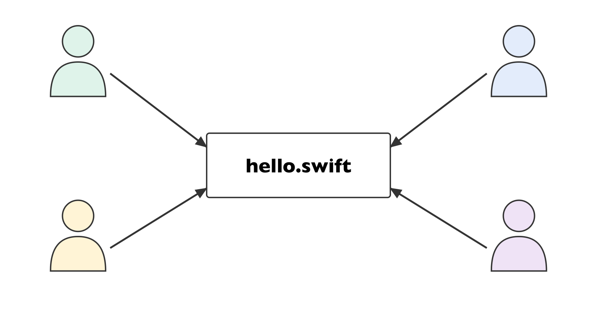

There is a second difficulty.

A program is often written by several developers, and they work at the same time, sometimes on the same file. In the picture, four developers work on the same file, hello.swift.

Their changes must be combined, without losing the work of anyone.

We also need to know who changed what, when, and why. For example, to understand where a bug comes from.

The answer to these problems is a version control system. This is what we study now.


### A short history of version control

- 1972 · SCCS (Bell Labs): versions of single files
- 1982 · RCS: versions of single files
- 1990 · CVS: whole projects, one central server
- 2000 · Subversion (SVN): an improved central server
- 2005 · Git (Linus Torvalds, open source): distributed, every computer has the full history

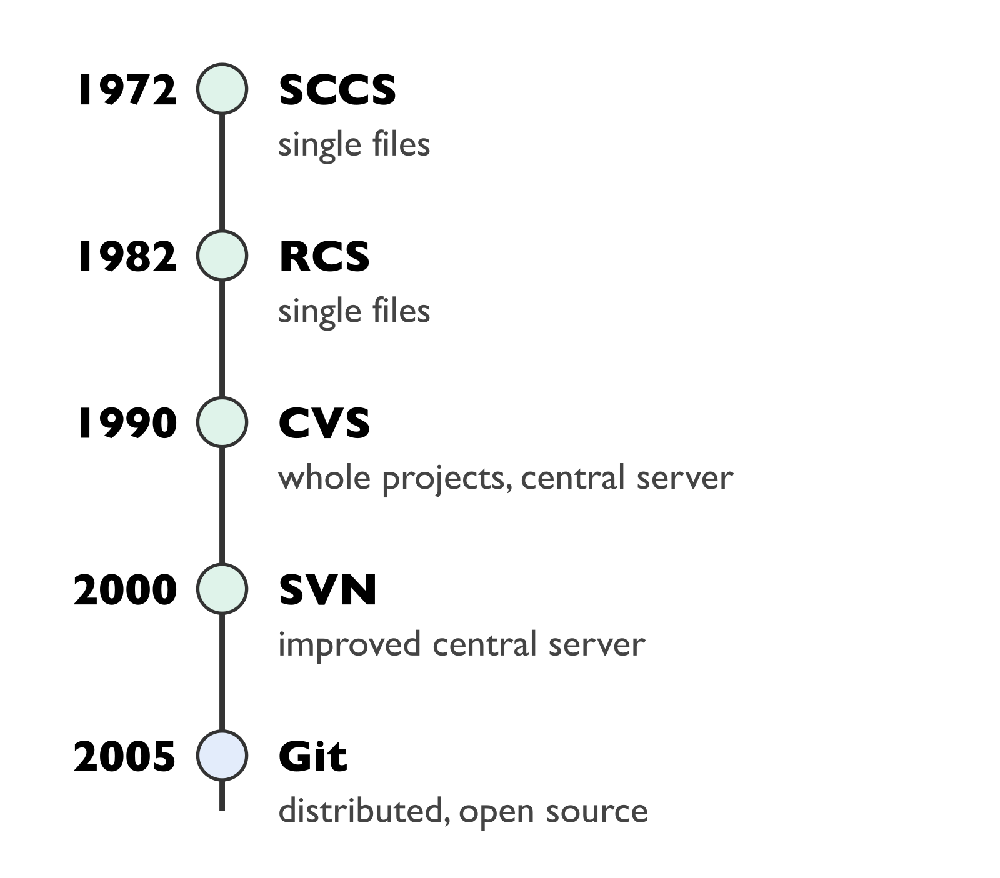

Version control is older than you may think. Look at the timeline on the right.

In 1972, SCCS, from Bell Labs, kept the versions of single files.

In 1982, RCS did the same, also for single files.

In 1990, CVS managed whole projects, with one central server where everybody sent their changes.

In 2000, Subversion, or SVN, improved this central server.

And in 2005, Linus Torvalds, the creator of Linux, wrote Git. Git is open source, and it is distributed: every computer has the full history of the project, not only the server. Today, Git is by far the most used.


### Git and the platforms that host it

- Git: the tool on your computer
- GitHub (2008, United States): the most used, part of Microsoft since 2018
- GitLab (2011, founders from Ukraine and the Netherlands): similar, can also be installed by a company
- Codeberg (2019, Germany): non-profit association, European alternative
- A repository can be public (everyone can read it) or private

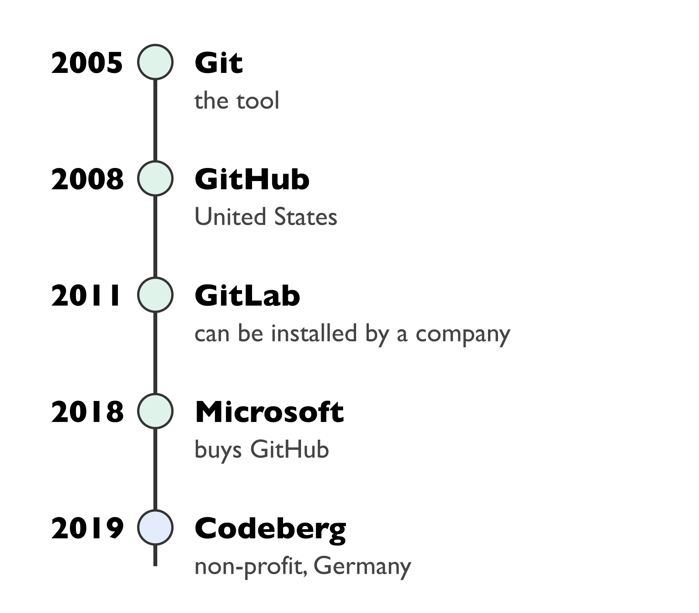

Be careful not to mix two things.

Git is a tool. It runs on your computer and it records the versions of your project.

GitHub is a website. It keeps a copy of your Git project online, so that other people can see it and work with you. GitHub was created in 2008, in the United States, and it belongs to Microsoft since 2018. It is the most used platform.

GitLab, created in 2011, is a similar platform. A company can also install it on its own servers.

Codeberg, created in 2019, is a European alternative, run by a non-profit association in Germany.

On these platforms, a repository can be public, so that everyone can read it, or private. In this course, we use GitHub, with public repositories.


### Two copies of your project

- Local repository: on your computer, where you work
- Remote repository: on GitHub, the shared and stable version
- You work locally, then you synchronise with the remote

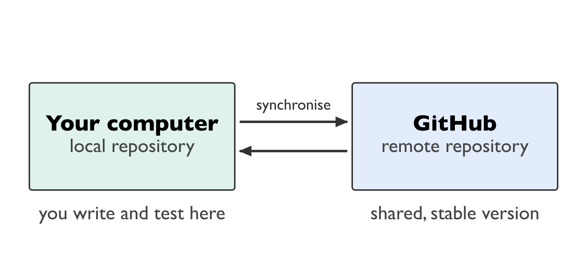

To understand Git, imagine two copies of your project.

The first copy is the local repository, on your computer. This is where you write your code and where you test it.

The second copy is the remote repository, on GitHub. This is the shared version, the one that the others can see.

You always work in the local copy. Then, from time to time, you synchronise the two copies. The arrows in the picture show this synchronisation, in both directions.


### commit: save a step

- A commit records a step of your work in the local repository
- Each commit has an identifier and a message: what changed
- Choose the file to save:
    git add hello.swift
- Record the step with a message:
    git commit -m "First version"
- See the history:
    git log

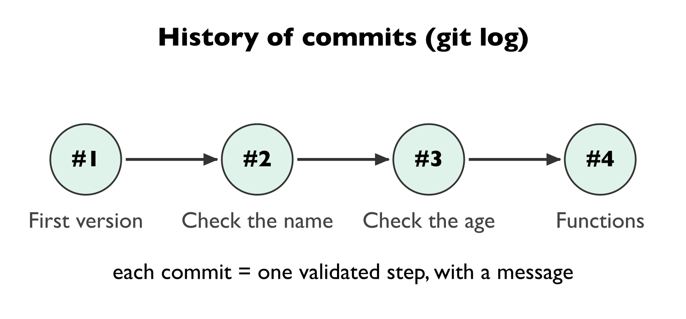

A commit records one step of your work in the local repository. Think of it as a save point.

Each commit has an identifier, a number given by Git, and a message written by you, that says what changed.

To make a commit, there are two commands.

First, you choose the file to save, with git add, followed by the name of the file. For example: git add hello.swift.

Then you record the step, with git commit, dash m, and a message between quotes. For example: git commit dash m "First version".

Finally, to see the history, that is the list of all your commits, you type git log. In the picture, you see four commits, one after the other.


### push and pull: synchronise

- Send your local commits to GitHub:
    git push
- Get the commits made by another person, or by you on another computer:
    git pull
- See the list of older versions:
    git log

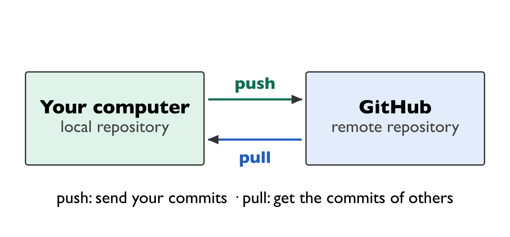

Your commits stay on your computer until you send them. Two commands synchronise the two copies.

To send your local commits to GitHub, you type git push. Push means: send.

To get the commits that are on GitHub, you type git pull. Pull means: bring. These commits can be made by another person, or by you, on another computer.

Be careful: pull is not used to go back in time.

To see the older versions of your program, you use git log, which shows the list of commits.


### Branch: try without breaking main

- main is the version that works
- A branch is a parallel line of work
- You commit in the branch, main does not change
- Create the branch new-branch and go into it:
    git switch -c new-branch

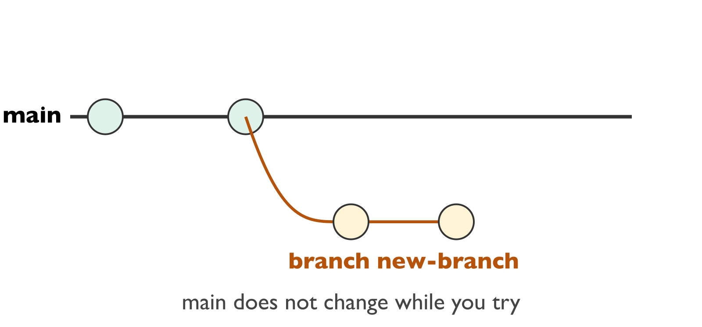

Now, an important idea: the branch.

The main version of your project is called main. It is the version that works.

A branch is a parallel line of work. It starts from main, and it lets you try something new.

You make your commits in the branch, and main does not change. If your idea does not work, main is still safe.

To create a branch and to go into it, you type git switch dash c, followed by the name of the branch. For example: git switch dash c new-branch.

In the picture, the branch new-branch leaves main and receives two commits, while main stays the same.


### Merge: bring the branch back

- The branch works: bring it back into main
- Go back to main:
    git switch main
- Add the work of the branch to main:
    git merge new-branch
- Send main to GitHub:
    git push

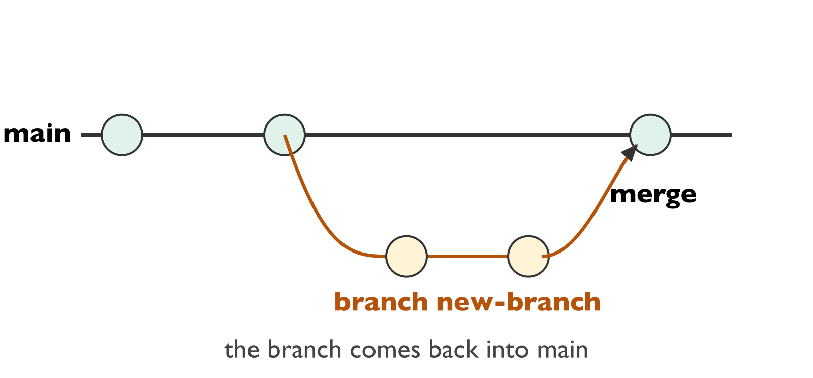

When the work in the branch is ready and tested, we bring it back into main. This is called a merge. There are three commands.

First, go back to main, with git switch main.

Second, add the work of the branch to main, with git merge, followed by the name of the branch. For example: git merge new-branch.

Third, send the new main to GitHub, with git push.

In the picture, the arrow shows the branch coming back into main.


### Release: name a stable version

- A tag gives a name to a stable version: v1.0
- Create the tag:
    git tag -a v1.0 -m "Version 1"
- Send the tag to GitHub:
    git push origin v1.0
- On GitHub: Releases, then publish v1.0

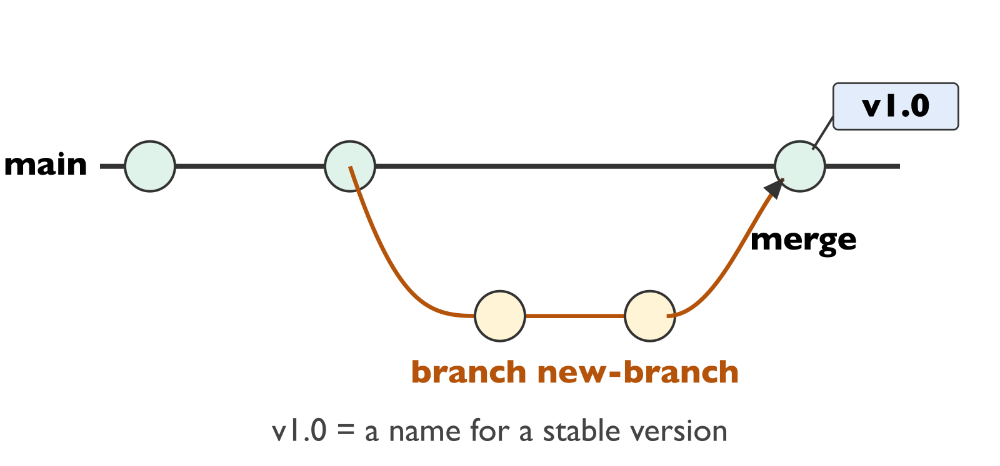

When a version is stable, we give it a name. This name is called a tag, for example v1.0.

To create the tag, you type git tag dash a v1.0, dash m, and a message between quotes.

To send the tag to GitHub, you type git push origin v1.0.

Then, on the GitHub page of your project, you open Releases and you publish v1.0. Anyone can now download exactly this version, even if the program changes later.


### Step by step · 1. A first program

```
$ mkdir hello              # a folder for the project
$ cd hello
$ nano hello.swift        # write the program, save: ctrl-O, quit: ctrl-X
print("Name?")
var name: String = readLine()!
print("Age?")
var age: Int = Int(readLine()!)!
print("Hello \(name), you are \(age)")

$ swift hello.swift
Name?
Ana
Age?
19
Hello Ana, you are 19
```

Now we follow a complete example in the terminal, step by step.

First, we create a folder for the project, called hello, with mkdir hello. The name of the folder is the name of the project.

We go into the folder with cd hello.

We open the editor nano to write the program, with nano hello.swift. To save, we press control O, and to quit, control X.

The program asks a name, then an age, and it says hello.

We run it with swift hello.swift. We type Ana, then 19, and the program answers: Hello Ana, you are 19. It works.


### 2. First commit

```
$ git init                 # inside the folder hello
$ git add hello.swift
$ git commit -m "First version: read name and age"

$ git log --oneline
62656f7 First version: read name and age
```

The program works, so we save this first step.

git init, inside the folder hello, creates the repository. It takes no name: the project is the folder.

git add hello.swift chooses the file.

git commit dash m "First version: read name and age" records the step with its message.

git log shows the history: one commit, with its identifier and its message.


### 3. Two problems: empty name, wrong age

```
$ swift hello.swift
Name?
                         # Enter: empty name
Age?
nineteen
Fatal error: Unexpectedly found nil

The empty name is accepted without any warning
Int("nineteen") gives nil, and the ! stops the program
```

Now we test two wrong inputs.

First problem: for the name, the user only presses Enter. The name is empty, and the program accepts it without any warning.

Second problem: for the age, the user types nineteen, in letters. The program stops, with a fatal error.

Why? Int of a text that is not a number gives nil, which means: no value. And the exclamation mark says: I am sure there is a value. Here there is none, so the program stops. In Swift, this is not an exception that we can catch: the program simply stops.

We will correct the two problems one at a time, each one in its own branch.


### 4. Branch check-name

```
$ git switch -c check-name

$ nano hello.swift        # change the program
var name: String = ""
while name == "" {        // empty name: ask again
    print("Name?")
    name = readLine()!
}

$ git commit -am "Ask the name again while it is empty"
$ git switch main
$ git merge check-name
```

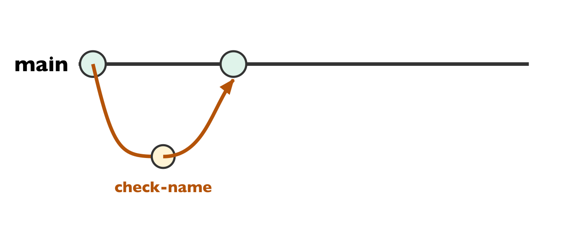

First correction: the name.

We create a branch called check-name, with git switch dash c check-name.

We open the program with nano, and we change the reading of the name: we read it in a while loop. As long as the name is empty, we ask again.

We test, then we record the change with git commit dash a m and a message. The option a adds all the files that changed.

We go back to main with git switch main, and we merge the branch with git merge check-name.

In the picture, the branch check-name comes back into main.


### 5. Branch check-age

```
$ git switch -c check-age

$ nano hello.swift        # change the program
var age: Int? = nil        // nil = no number yet
while age == nil {        // Int("abc") gives nil: ask again
    print("Age?")
    age = Int(readLine()!)
    if age == nil {
        print("This is not a number, try again")
    }
}
print("Hello \(name), you are \(age!)")

$ swift hello.swift
Age?
nineteen
This is not a number, try again
Age?
19
Hello Ana, you are 19
```

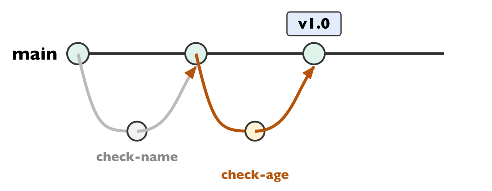

Second correction: the age, in a new branch called check-age.

The type Int with a question mark means: an integer, or nil. We start with nil.

As long as age is nil, we ask again. Int of the text gives a number, or nil if the text is not a number.

If age is still nil, we print: This is not a number, try again.

At the end, we use age with an exclamation mark: now we are sure there is a value.

When the user types nineteen, the program says that this is not a number and asks again, instead of stopping.


### 6. Merge and version v1.0

```
$ git commit -am "Ask the age again while it is not a number"
$ git switch main
$ git merge check-age
$ git tag -a v1.0 -m "Version 1: checks without functions"
$ git remote add origin https://github.com/ACCOUNT/hello.git
$ git push origin main --tags

$ git log --oneline
40e12e8 (tag: v1.0) Ask the age again while it is not a number
6d21987 Ask the name again while it is empty
62656f7 First version: read name and age
```

We commit the change in the branch check-age.

We go back to main, and we merge check-age.

Now the program checks the name and the age: it is a stable version. We give it the name v1.0, with git tag.

We connect our folder to the repository hello created on GitHub, only once, with git remote add origin, followed by the address of the repository.

Then we push main and the tags to GitHub.

git log shows our three steps, and the tag v1.0 on the last one.


### 7. Branch functions

```
$ git switch -c functions
$ nano hello.swift        # change the program
func readName() -> String {
    var name: String = ""
    while name == "" {
        print("Name?")
        name = readLine()!
    }
    return name
}
func readAge() -> Int {
    var age: Int? = nil
    while age == nil {
        print("Age?")
        age = Int(readLine()!)
        if age == nil { print("This is not a number, try again") }
    }
    return age!
}
var name: String = readName()
var age: Int = readAge()
```

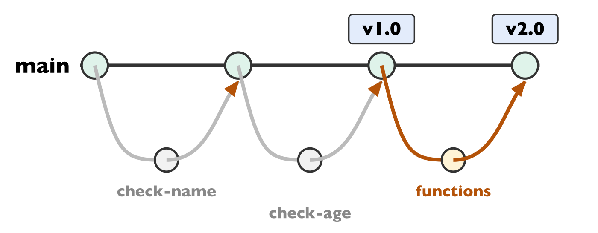

Last improvement, in a new branch called functions.

We move the reading of the name into a function called readName. It asks the name until it is not empty, and it returns it.

We move the reading of the age into a function called readAge. It asks the age until it is a number, and it returns it.

The main program becomes two lines: name equals readName, and age equals readAge. It is easier to read.

The behaviour does not change: we test it again.

In the picture, the branch functions follows check-name and check-age.


### 8. Merge and version v2.0

```
$ git commit -am "Version 2: readName and readAge functions"
$ git switch main
$ git merge functions
$ git tag -a v2.0 -m "Version 2: with functions"
$ git push origin main --tags

$ git log --oneline
c5b5b2c (tag: v2.0) Version 2: readName and readAge functions
40e12e8 (tag: v1.0) Ask the age again while it is not a number
6d21987 Ask the name again while it is empty
62656f7 First version: read name and age
```

We commit, we go back to main, and we merge the branch functions.

We give this version the name v2.0, and we push main and the tags to GitHub.

Now the history tells the whole story: the first version, the two corrections, version 1.0 without functions, and version 2.0 with functions.


### The three versions

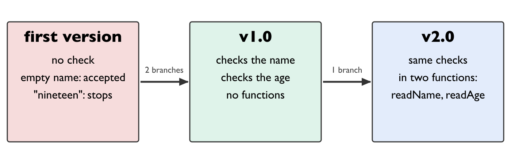

Let us look back at the three versions of our program.

The first version had no check: an empty name was accepted, and a wrong age stopped the program.

With two branches, check-name and check-age, we built version 1.0: it checks the name and the age, without functions.

With one more branch, functions, we built version 2.0: the same checks, written in two functions, readName and readAge.

Git kept every step, and the tags let anyone come back to version 1.0 or version 2.0.

This example is on GitHub, at the address shown on the slide. You can clone the repository, look at its history, and switch to version 1.0 or version 2.0 to run each one.


### Lab 1 · Your first repository

- 1. Create your GitHub account with your university email
- 2. Create a public repository
- 3. git clone the repository on your computer
- 4. Add a small Swift program, git add, git commit
- 5. git push, then check on GitHub that your commit is there

Now it is your turn. In this first lab, you work alone.

Create your GitHub account, with your university email.

Then, on GitHub, create a public repository.

Copy it on your computer with git clone, followed by the address of the repository.

Add a small Swift program, then git add and git commit.

Finally, type git push, and check on the GitHub page that your commit is there.


### Lab 2 · Get the code of another student

- 1. Give the address of your repository to another student
- 2. git clone the address you receive
- 3. Run the program of your classmate
- 4. When your classmate pushes a new commit: git pull, then run again

Second lab, with a classmate.

Give the address of your repository to another student.

Your classmate copies it with git clone. The repository is public, so this works without any password.

Then your classmate runs your program.

When you push a new commit, your classmate only needs git pull to get it, and runs the program again.


### Apply it to your Battleship

- Repository iap-battleship, public, one per student
- Commit part 1 (ships placed by hand)
- Add part 2 (random placement) in a branch, merge it
- Release v1.0
- Submit the address in the Moodle workshop: your code will be reviewed by other students for quality

Finally, you apply all this to your Battleship.

Create a public repository named iap-battleship. There is one repository per student.

Commit part 1, where you place the ships by hand.

Add part 2, the random placement, in a branch, and merge it into main.

Publish the release v1.0.

Then submit the address of your repository in the Moodle workshop. Other students will review the quality of your code, and you will review theirs.
